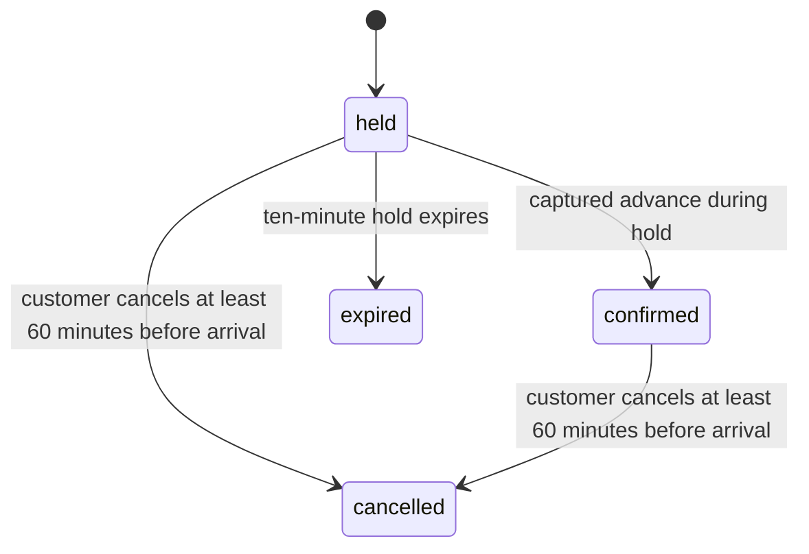
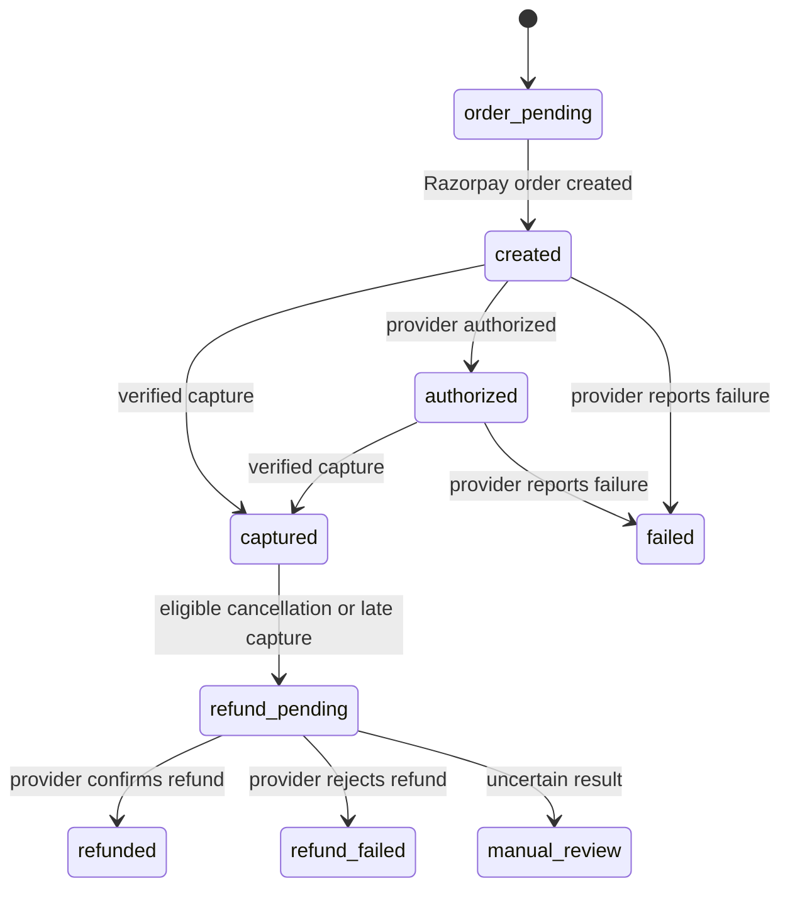
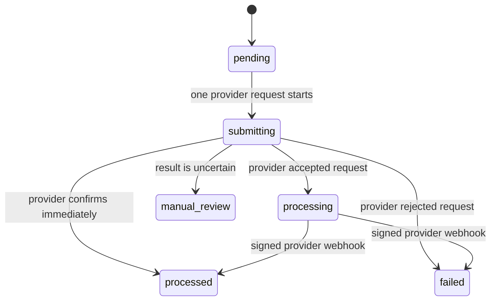

# Maintenance guide

## Project status

This is a functioning website with a date-and-arrival-time booking flow. The selected time reserves when a customer should arrive; it does not promise when their service will begin. Service durations and employee records are not used by this booking model. The checkout switch is off; do not collect payments until the launch gate in the deployment runbook passes.

The current environment has no verified MongoDB URI, Razorpay API/webhook credentials, email provider key, owner inbox, or staging deployment. A staff roster is not required. Time browsing follows the configured salon schedule; booking holds and payments remain unavailable until the required services are configured.

## Multi-page site and content review

The client routes are defined in `client/src/routes.js`; `client/src/App.jsx` renders the home, story, category overview, category menus, visit, booking gate, and not-found pages. The router uses the browser History API and requires a static-host fallback to `client/dist/index.html` for direct page loads. Keep `/api/*` routed to Express.

Menu pages use the stable category labels from `server/src/config/salon.js`. The home page intentionally shows only a selected set, while category pages list the full corresponding category. Preserve each service ID because bookings store a service snapshot. Review source wording and approval questions in `MENU_DATA_REVIEW.md` before changing a service; the supplied PDF was reviewed and current owner questions are documented there.

Approved image paths, alt text, and fallback artwork are configured in `client/src/service-images.js`. Put approved files in `client/public/images/brand`, `client/public/images/services`, or `client/public/images/gallery`, then set the matching `src` to a verified local file path. A `null` mapping shows CSS artwork and makes no image request. Do not put image search results or files with unclear rights in the public folder. The D monogram remains an interim text mark until the salon supplies an approved standalone logo. Supplied customer-feedback excerpts appear in the carousel without an aggregate rating claim.

## Architecture and folder map

```text
client/
  index.html                 Page title and SEO metadata
  vite.config.js             Vite development API proxy and build config
  src/App.jsx                Shared header/footer and route page components
  src/routes.js              Supported client paths and route/category helpers
  src/service-images.js      Approved local image map and expected filenames
  src/BookingWidget.jsx      Availability UI, Razorpay Checkout, status/cancellation
  src/api.js                 API base URL handling
  src/styles.css             Responsive layout, focus styles, reduced motion
  public/images/             Owner-approved logo, category, and gallery assets
  test/routes.test.js        Client route-map and category-filter tests
server/
  src/server.js              Environment, database/index startup, background worker
  src/app.js                 Express routes, validation, middleware, errors
  src/config/salon.js        Salon schedule, public content, service data
  src/booking/availability.js Timezone and arrival-time calculation
  src/booking/workflows.js   Holds, payments, cancellation, refund, webhook workflows
  src/booking/audit.js       Deduplicated state-transition audit writes
  src/booking/notifications.js Email outbox and notification worker
  src/booking/notification-mode.js Safe Resend/mock mode restrictions
  src/booking/reservation-locks.js Legacy per-employee lock helper; not used by arrival-time bookings
  src/booking/razorpay.js    Server-side Razorpay calls and signatures
  src/models/                Mongoose schemas and indexes
  scripts/sync-staff.js      Legacy private staff roster import; not required for arrival-time bookings
  test/                      API, schedule, policy, signature, mock, lock tests
```

The React site reads public salon and service data from Express. Express connects to MongoDB and owns all booking/payment state. Razorpay Checkout appears only after the server creates an order. A background worker expires holds and processes refund/email outboxes. The worker and APIs share state in MongoDB; no booking list or admin HTTP route is exposed.

## Routine commands

Run from the repository root:

```powershell
npm install
npm run dev
npm test
npm run build
```

The server tests use Node’s built-in test runner and Supertest. Tests cover the public API/configuration, availability time math, staff-specific schedules and capacity, cancellation timing, notification-mode safety, HMAC verification, and reservation lock buckets. They do not substitute for MongoDB replica-set concurrency tests or Razorpay sandbox/webhook tests. There is no lint command configured; `npm run` lists the available scripts.

The combined root test command runs the server’s API/workflow suite and the client route/category/image-map tests. The client tests are in `client/test/routes.test.js`; they check each required path, normalization, unknown paths, category filtering, and that configured image paths resolve to local files. The build check does not perform screenshot-based visual QA.

## Business configuration

### Salon and services

Edit `server/src/config/salon.js`. The current profile, address, call/WhatsApp numbers, seven-day hours, and customer-supplied menu are in that file. Update them when the salon approves corrections. A service can appear in booking when it has a positive price and its customer-facing name and inclusions do not need confirmation. Service duration and staff eligibility are not checked. `priceDisplay` is customer-facing; percentage offers need a final price before online booking. Keep service IDs stable after bookings exist because bookings store service snapshots.

The supplied schedule is configured as Monday-Sunday, 9:00 AM-9:00 PM Asia/Kolkata. Arrival times are offered every 15 minutes and only future times are returned. An individual service without a confirmed price, name, or package description remains outside the booking selector; other clear, priced services can be selected. See `MENU_DATA_REVIEW.md` for remaining content questions. Add salon photographs only with permission.

`salon.bookingSchedule.ownerApproved` is currently true for the supplied Monday-Sunday 9:00 AM-9:00 PM schedule. Set it back to false if the salon changes or withdraws approval; add breaks, holidays, and special opening periods before reopening checkout.

### Employee roster (not used by current booking flow)

Customers do not choose an employee and the server does not assign one. The booking holds an arrival time for the salon; the team starts the service when someone is available. `Staff`, `SlotReservation`, and `scripts/sync-staff.js` remain for legacy data and are not readiness requirements. Do not describe the arrival time as a guaranteed service start.

### Schedule edits and timezones

Arrival availability and timestamps use the salon IANA timezone. Use 24-hour `HH:mm` schedule values. The current default is `Asia/Kolkata`; weekly hours are Monday-Sunday, 09:00-21:00. API arrival times use a 15-minute interval and the booking horizon defaults to 60 days. The client starts on tomorrow after closing time; the server rejects past or out-of-horizon dates.

## Booking, payment, and refund lifecycle

The customer selects a service, date, and 15-minute arrival time. The server validates that the service has an approved price, that the date/time is in the future and inside salon hours, and that the date is within the configured booking horizon. In one MongoDB transaction it creates a 10-minute payment hold and an `ArrivalReservation`. The unique `{ visitDate, slotAt }` index permits only one active booking at that exact arrival time. This is an arrival-time lock, not a service-duration or employee-capacity calculation. Transactions require a replica-set or sharded MongoDB deployment; standalone MongoDB cannot provide this guarantee.

An unexpired hold lasts 10 minutes. A server worker expires stale holds and removes their reservations. The TTL index is cleanup assistance only; code checks `expiresAt` and does not depend on MongoDB TTL timing for correctness. `Idempotency-Key` makes retrying one hold request safe.

| Record | State | Meaning |
| --- | --- | --- |
| Booking | `held` | Arrival time reserved briefly; payment not yet confirmed. |
| Booking | `confirmed` | Razorpay captured the advance for an active arrival-time hold. |
| Booking | `cancelled` | Customer cancelled; the arrival time has been released. |
| Booking | `expired` | Arrival-time hold elapsed before successful capture. |
| Payment | `authorized` | Provider authorization only; this is not appointment confirmation. |
| Payment | `captured` | ₹100 advance collected and credited against the service price. |
| Payment | `refund_pending` | Full advance refund submitted or queued for provider verification. |
| Payment | `refunded` | Provider confirmed the refund as processed. |
| Payment | `manual_review` | Provider response/amount is uncertain; operator must reconcile. |
| Refund | `pending` / `submitting` | Refund request is queued or being submitted once. |
| Refund | `processing` | Provider accepted the request; final status is awaited. |
| Refund | `processed` / `failed` | Provider webhook or immediate response reported the final status. |
| Notification | `mocked` | Local mock transport recorded an event; no email was sent or delivered. |
| Notification | `accepted` | Email provider accepted the request; recipient delivery is not confirmed by this state. |







The amount is fixed in `server/src/booking/workflows.js` as `ADVANCE_PAISE = 10_000`. If the salon changes the advance, update the server constant, booking consent and summary in `client/src/BookingWidget.jsx`, notification text, tests, approved policy, and versioned terms together. Do not accept amounts from the browser.

Customer cancellation is available with the high-entropy management token returned at hold creation, up to one hour before the selected arrival time. The API enforces the cutoff in the transaction and returns `CANCELLATION_WINDOW_CLOSED` inside that period. A qualifying customer cancellation refunds the full captured advance to the original payment method. The database stores only a SHA-256 token hash. The browser keeps the token in `sessionStorage`, so customers need to manage the booking from that browser session; closing the tab can remove access. The endpoint does not expose a public booking lookup. Rescheduling, login, email management links, and an operator HTTP dashboard are not implemented.

Refund API dispatch is locally idempotent. If the network result is ambiguous, the record moves to `manual_review`; it is intentionally not retried automatically. Check the Razorpay dashboard and event history first. Provider refund events with `refund.processed` or `refund.failed` update the local final state. Do not mark a refund complete based only on a request response unless the provider reports it as processed.

## Email notification worker

The durable outbox stores notification events with a dedupe key and sends plain-text mail through Resend. Production readiness requires `OWNER_EMAIL`, `EMAIL_FROM`, and `RESEND_API_KEY`; customer email is optional. A 2xx provider response is stored as `accepted`, not as recipient delivery confirmation. Delivery retries with backoff, then marks the event `manual_review`. The server worker also reclaims stale send leases. Check provider delivery logs when the outbox stops progressing. Email notifications contain customer name/phone and appointment details, so keep provider access and database access restricted. No SMS or WhatsApp provider is configured.

For local development only, `.env.example` sets `NOTIFICATIONS_MODE=mock`. The worker marks outbox entries `mocked` with `MOCK_MODE_NO_DELIVERY`; no message is sent, and the status must never be described as delivered. Mock mode is refused in production and with Razorpay live mode. Use `NOTIFICATIONS_MODE=resend` with the real sender/owner configuration in staging and production. The mock changes notification delivery only; it does not simulate a payment or bypass MongoDB transaction support, price/name eligibility, policy, or Razorpay test-mode readiness gates.

## Database collections and indexes

- `bookings`: visit lifecycle, customer contact and service snapshot, hashed management-token proof, visit date and arrival time.
- `arrivalreservations`: one unique `{ visitDate: 1, slotAt: 1 }` lock per arrival time; a partial TTL index assists expired-hold cleanup.
- `staff` and `slotreservations`: legacy collections, not used by the current arrival-time flow.
- `payments`: Razorpay order/payment IDs, ₹100 amount and provider lifecycle, separate from booking state.
- `refunds`: idempotency key, requested amount, provider refund ID and tracked provider status.
- `webhookevents`: provider-event deduplication and processing status.
- `notifications`: durable mail outbox and dedupe state.
- `bookingauditevents`: append-only deduplicated booking/payment/refund transition records. Customer contact fields and payment credentials are intentionally excluded.

At startup, the API checks transaction support and initializes models/indexes. Booking readiness does not check service duration or employee roster. Do not remove or rebuild the unique arrival reservation index while bookings are active. Use database backups before changing collection schemas. Never run destructive index synchronization against production without reviewing its effect.

## API and website changes

See [API_REFERENCE.md](API_REFERENCE.md). Booking-specific public actions are limited to arrival-time availability, placing a short-lived hold, verifying a payment, token-protected single-booking status/cancellation, and the signed Razorpay webhook. There are no unauthenticated booking reads, list endpoints, or admin routes.

If the website and API have different HTTPS origins, build with `VITE_API_BASE_URL` set to the API origin, then set `CLIENT_ORIGIN` on the API to the exact website origin. The browser only receives the public Razorpay key ID and server-created order ID.

## Security and privacy

- Keep `.env`, the private staff roster, exports, and database credentials out of Git. `.gitignore` excludes local secrets and roster JSON.
- `RAZORPAY_KEY_SECRET`, `RAZORPAY_WEBHOOK_SECRET`, and Resend credentials belong only in the backend secret manager.
- Use HTTPS, database TLS, restricted network access, least-privilege users, and MFA for provider dashboards.
- Customer names, phones, optional emails, appointments, payment references, and refund references are personal/financial records. Do not log them or place them in URLs/analytics.
- Do not collect card or UPI PIN data. Razorpay Checkout handles payment instrument data.
- The management token is a bearer secret. Keep it out of logs and support tickets.
- Complete the salon’s privacy notice, contact, retention period, and deletion process before enabling booking. No automated personal-data retention deletion is configured yet.

## Backup and recovery

Use encrypted automated database backups or point-in-time recovery. Back up and restore all application collections together so visit, arrival reservation, payment, refund, and audit state stay linked.

If a payment was captured for an expired/cancelled hold, the server creates a full-advance refund request. If the result is ambiguous, follow the manual review procedure before any further request. If an email provider is down, the outbox retries and eventually flags delivery for review; a provider dashboard can help determine delivery.

## Change history and release practice

Keep release notes in [CHANGELOG.md](CHANGELOG.md). Before a release run `npm test` and `npm run build`; do not deploy secrets or the ignored staff file. Follow [MANUAL_QA_CHECKLIST.md](MANUAL_QA_CHECKLIST.md) for visual, keyboard, accessibility, and staging transaction checks. Run provider and replica-set integration checks in staging before turning on `BOOKING_ENABLED`.

## Environment variables

Copy `.env.example` to the ignored root `.env` for local API work. Set hosting secrets directly in the API host’s secret manager, not in Vite variables or a committed file.

- API/runtime: `PORT`, `NODE_ENV`, `CLIENT_ORIGIN`, `TRUST_PROXY_HOPS`.
- Database and calendar: `MONGODB_URI`, `SALON_TIMEZONE`, `MONGODB_TRANSACTIONS_SUPPORTED` (set by server startup), `MAX_BOOKING_DAYS_AHEAD`.
- Booking/policy: `BOOKING_ENABLED`, `BOOKING_POLICY_VERSION`, `PRIVACY_POLICY_VERSION`.
- Payment: `RAZORPAY_MODE`, `RAZORPAY_KEY_ID`, `RAZORPAY_KEY_SECRET`, `RAZORPAY_WEBHOOK_SECRET`.
- Email: `NOTIFICATIONS_MODE`, `OWNER_EMAIL`, `EMAIL_FROM`, `RESEND_API_KEY`, `PUBLIC_SALON_NAME`.
- Frontend hosting: optional `VITE_API_BASE_URL` in the client build environment; leave unset for same-origin/proxy deployment.

The development notification mock is allowed only with `NODE_ENV=development` or `test` and Razorpay test mode. `BOOKING_ENABLED=false` remains the safe default. Provider keys must never use a `VITE_` prefix.

## Feature-to-file reference

| Change | Files to review |
| --- | --- |
| Salon identity, phone, address, hours, map, services, prices, durations | `server/src/config/salon.js`; public rendering in `client/src/App.jsx` |
| Logo, approved salon photos, colors, typography | `client/src/App.jsx`, `client/src/styles.css`, `client/public/` |
| Arrival-time schedule and interval | `server/src/config/salon.js`; arrival slots in `server/src/booking/availability.js` |
| Availability math and timezone conversion | `server/src/booking/availability.js`, `server/src/app.js` |
| Arrival-time locks, holds, payments, cancellation and refunds | `server/src/booking/workflows.js`, `server/src/models/ArrivalReservation.js`, related `server/src/models/` |
| Razorpay request/signature behavior | `server/src/booking/razorpay.js`, `server/src/app.js`, `.env.example` |
| Audit entries | `server/src/booking/audit.js`, `server/src/models/BookingAuditEvent.js` |
| Email/mock delivery | `server/src/booking/notifications.js`, `server/src/booking/notification-mode.js`, `server/src/models/Notification.js` |
| Booking form, consent, accessibility and cancellation copy | `client/src/BookingWidget.jsx`, `client/src/App.jsx`, `client/src/styles.css` |
| Routes and errors | `server/src/app.js`, `API_REFERENCE.md` |
| Deployment, secrets, backups, rollback | `DEPLOYMENT_RUNBOOK.md`, this guide |

## Troubleshooting

| Symptom | Likely cause | Safe next step |
| --- | --- | --- |
| Service menu does not load | API unavailable or wrong `VITE_API_BASE_URL`/proxy | Check browser network panel and API logs; verify `/api/services` and CORS. |
| Booking says it is being prepared | Expected: missing database, provider settings, notification setup, policy approval, or `BOOKING_ENABLED` | Read `/api/booking/readiness`; supply missing approved inputs. Do not force the flag around other blockers. |
| Availability returns 503 | The selected service has unresolved pricing/name details or the schedule configuration is invalid | Check the response error code and service configuration. Time browsing does not require payment readiness or MongoDB. |
| Selected time becomes unavailable | Another customer reserved that exact arrival time | Offer another returned arrival time; do not bypass the hold API or unique arrival index. |
| Checkout does not confirm the appointment | Razorpay order, signature, amount, or capture status is incomplete | Check payment and webhook IDs in Razorpay; only a verified captured payment confirms. |
| Booking is confirmed but email is not visible | Email outbox is pending/retrying, provider only accepted the request, or recipient delivery failed | Inspect the notification record and Resend logs. `accepted` does not mean delivered. |
| Notification status says `mocked` | Development-only transport is active | No email was sent. Use `NOTIFICATIONS_MODE=resend` and a verified sender for staging. |
| Cancellation reports cutoff closed | Appointment begins in less than one hour | Customer must contact the salon; do not edit the booking record directly. |
| Refund status is `manual_review` | Provider outcome is uncertain or refund reference is missing | Check Razorpay by payment/refund reference and reconcile once before any retry. |
| API cannot start transactions | Standalone MongoDB or broken replica-set/sharded configuration | Use a transaction-capable deployment and confirm the `hello` result at startup. |

## Deployment and rollback

Use the sequence in [DEPLOYMENT_RUNBOOK.md](DEPLOYMENT_RUNBOOK.md). Build and review a release artifact, run the automated suite, then deploy API and frontend to staging. Confirm migration/index readiness and exercise test payment/refund before enabling bookings. Use separate environment secrets for each environment.

For a bad frontend release, redeploy the previous built artifact. For an API release, roll back to a compatible artifact only if its schema assumptions remain valid. Keep database changes backward-compatible while bookings exist; never restore an older database over current live data just to fix application code. If payment/refund state may be affected, turn `BOOKING_ENABLED=false`, preserve logs/audit events, reconcile Razorpay, then restore from a verified backup only under the runbook’s recovery procedure.

## Maintenance checklist

Before deployment: review `git diff`, run `npm test`, `npm run build`, `git diff --check`, inspect readiness on staging, run [MANUAL_QA_CHECKLIST.md](MANUAL_QA_CHECKLIST.md), and confirm secrets are ignored. After deployment: check health/readiness, server and outbox errors, Razorpay webhook delivery, arrival reservation conflicts, and MongoDB backups. Rehearse restores in an isolated database.
